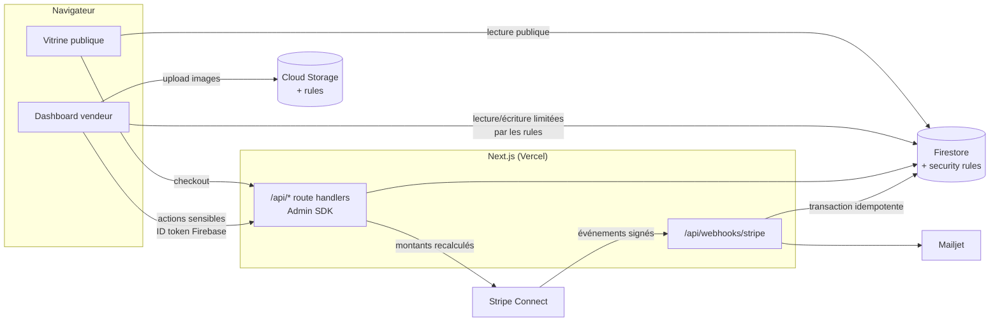

# Boumly

**La boutique en ligne des artisans et créateurs qui vendent en local.** Chaque vendeur crée sa vitrine en quelques minutes, encaisse par carte via Stripe Connect et gère ses commandes, ses ateliers et ses marchés depuis un tableau de bord.

🌐 **En production : [boumly.com](https://www.boumly.com)**


## Le problème

Un artisan qui vend sur les marchés ou en atelier perd des ventes dès qu'il n'est pas là. Les solutions e-commerce classiques sont pensées pour l'expédition nationale, avec abonnement mensuel et configuration lourde. Boumly vise le commerce local : click & collect, livraison dans un rayon donné, réservation d'ateliers, paiement en ligne ou sur place, sans abonnement (une commission par vente).

## Fonctionnalités

**Vitrine et commande**
- Boutique publique `/store/[slug]` avec produits, options, variantes et suivi de stock.
- Panier par boutique, conservé dans le navigateur.
- Retrait sur place, livraison locale (rayon et frais) ou expédition par zones (nationale, régionale, internationale).
- Choix d'un créneau de retrait ou de livraison, avec délai de prévenance et horizon de réservation configurables.
- Codes promo revalidés côté serveur et commande sans compte (invité).

**Paiements (Stripe Connect)**
- Onboarding des vendeurs avec les composants Stripe embarqués (Accounts v2) ; versements directement sur leur compte.
- *Destination charges* avec commission de la plateforme (`application_fee_amount`).
- Multi-devise : le pays du vendeur fixe la devise, et les montants sont convertis en unités mineures selon la devise.
- Frais Stripe réels relevés sur la `balance_transaction` pour afficher au vendeur son net exact.

**Tableau de bord vendeur**
- Commandes en temps réel (abonnement Firestore), en liste ou en calendrier par jour de retrait, avec récapitulatif de production.
- Commandes manuelles (espèces, ou lien de paiement envoyé au client), fichier clients, codes promo.

**Ateliers et marchés**
- **Ateliers** : prestations réservables par créneau, avec capacité et liste d'attente promue automatiquement, politique d'annulation et remboursements Stripe.
- **Marchés** : un organisateur publie un événement, les artisans candidatent pour un stand, l'organisateur valide puis l'artisan paie sa place en ligne.

**Transverse**
- Internationalisation français et anglais (`next-intl`).
- E-mails transactionnels (Mailjet).
- SEO : métadonnées par page, sitemap, image Open Graph générée.
- Autocomplétion d'adresse et géocodage (Mapbox).

## Stack technique

| Couche | Technologies |
|---|---|
| Front | Next.js 16 (App Router), React 19, TypeScript strict, Tailwind CSS v4, shadcn/ui, Framer Motion |
| Formulaires | react-hook-form, Zod 4 (schémas partagés client et serveur) |
| Back | Route handlers Next.js (runtime Node), Firebase Admin SDK |
| Données | Firestore (temps réel), Cloud Storage, Firebase Auth (e-mail et Google) |
| Paiement | Stripe Connect, Payment Intents, webhooks signés |
| Services | Mailjet (e-mails), Mapbox (adresses), Vercel (hébergement) |

## Architecture



Les écritures sont réparties selon leur sensibilité :
- **Le client écrit directement dans Firestore** pour ce qui ne touche ni à l'argent ni aux droits : profil, boutique, produits, codes promo. Les règles de sécurité imposent la propriété des documents et verrouillent les champs gérés par le serveur.
- **Tout ce qui touche à l'argent ou à un tiers passe par une route serveur** avec l'Admin SDK : commandes, réservations, inscriptions, champs Stripe. Côté Firestore, ces collections sont en `create: false`.

```
src/
  app/[locale]/       pages (vitrine, dashboard, auth, pages légales) — routing i18n
  app/api/            routes serveur : checkout, orders, bookings, events, connect, webhooks
  features/           modules métier (store, products, orders, bookings, events, onboarding…)
  lib/                logique serveur (checkout, booking, connect, emails, validations Zod)
  services/           accès Firestore côté client
  components/         UI partagée (shadcn), layout, SEO
firestore.rules       règles de sécurité Firestore
storage.rules         règles de sécurité Storage
```

## Sécurité

- **Montants jamais fournis par le client** : le prix, les options, les frais de livraison et la remise sont recalculés côté serveur à partir de Firestore avant la création du PaymentIntent.
- **Webhooks Stripe vérifiés** par signature sur le corps brut (`constructEventAsync`), et traités dans une **transaction Firestore idempotente** : un événement rejoué par Stripe ne déclenche ni double mise à jour ni double e-mail.
- **Règles Firestore en refus par défaut** :
  - chaque collection déclare qui peut lire et écrire ;
  - les champs Stripe et d'identité sont verrouillés (`affectedKeys`) ;
  - le pays de la boutique devient immuable après l'onboarding Stripe ;
  - les codes promo ne sont jamais lisibles publiquement.
- **Authentification des routes** par ID token Firebase vérifié avec l'Admin SDK (`requireUid`), et contrôle d'appartenance à chaque action : vendeur de la boutique, organisateur de l'événement, client de la réservation.
- **Accès invité par capability** : une commande passée sans compte se consulte via son identifiant aléatoire, et la route ne renvoie qu'un sous-ensemble public (pas de données financières du vendeur).
- **Uploads limités** aux images matricielles de moins de 5 Mo (SVG refusé), dans le dossier de l'utilisateur.
- **E-mails** : contenu échappé, destinataire du formulaire de contact fixé côté serveur.

## Lancer en local

Prérequis : Node.js 20+, un projet Firebase (Auth, Firestore, Storage), un compte Stripe en mode test avec Connect activé, et la [CLI Stripe](https://stripe.com/docs/stripe-cli).

```bash
npm install
cp .env.example .env.local          # renseigner les clés (voir commentaires)
firebase deploy --only firestore:rules,firestore:indexes,storage   # règles et index
npm run stripe:webhook              # relaie les webhooks vers localhost, affiche le whsec_
npm run dev                         # http://localhost:3000
```

## Qualité

```bash
npx tsc --noEmit    # typage strict
npm run lint        # ESLint (règles Next.js, React Compiler)
npm run build
```

La CI GitHub Actions exécute ces trois étapes à chaque push.

## Pistes d'amélioration

- Limitation de débit (rate limiting) sur les routes publiques : contact, validation de code promo, checkout.
- Tests de bout en bout Playwright sur les parcours de commande et de réservation, avec l'émulateur Firebase et Stripe en mode test.
- Tests unitaires des règles Firestore avec `@firebase/rules-unit-testing`.

## Auteur

**Manuel Briand** · [GitHub](https://github.com/ManuelBriand) · [Site](https://manuelbriand.github.io)

Code publié à titre de démonstration, tous droits réservés.
